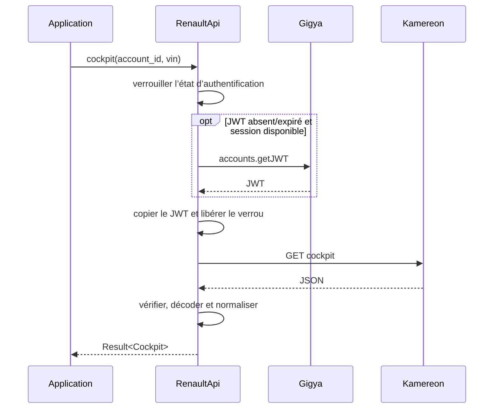

# Architecture, exécution et concurrence

[Sommaire](README.md) · [Développement](developpement.md)

## Organisation

| Module | Responsabilité |
|---|---|
| `client.rs` | Client HTTP, session, A2F, découverte et lectures |
| `auth.rs` | Entrées/résultats d’authentification, appareil, claims et secrets temporaires |
| `config.rs` | Locales, régions, racines et délais |
| `wire.rs` | Structures JSON privées, décodage et normalisation |
| `models.rs` | Structures publiques indépendantes des enveloppes Renault |
| `error.rs` | Contrat d’erreurs public |
| `vehicle.rs` | Lectures supplémentaires, historiques, commandes et programmations |
| `endpoints.rs` | Table générée de 28 fonctions et 25 codes modèles |

Le Python est une référence du protocole. Le Rust n’en reproduit pas la chaîne
de proxies `Client → Account → Vehicle → Session`. Les appels publics passent
directement un compte et un VIN au client.

## Chemin d’une lecture asynchrone

Le pool HTTP et l’état sont partagés via `Arc`. Un mutex Tokio protège les
identifiants et les métadonnées. Il empêche plusieurs renouvellements simultanés
du même JWT. Le verrou est détenu pendant les échanges Gigya nécessaires au
parcours d’authentification.

Les GET Kamereon s’exécutent après copie du jeton et libération du verrou ; ils
peuvent donc être en vol simultanément. Des lectures concurrentes dont les
codes modèles ne sont pas encore connus peuvent demander les détails plusieurs
fois : il n’existe pas de déduplication générale des requêtes de télémétrie.

## État conservé en mémoire

| Élément | Durée / usage |
|---|---|
| Jeton de session Gigya | Jusqu’à remplacement, logout ou invalidation reconnue |
| JWT + exp | Réutilisé tant qu’il dépasse la marge de 60 secondes |
| personId | Découverte des comptes dans la session courante |
| gmid/ucid | Reconnaissance de l’appareil ; exportable explicitement |
| Challenge, assertions, mot de passe A2F | Jusqu’à réussite, annulation ou remplacement du challenge |
| Codes modèles par compte/VIN | Routage et unités ; pas de TTL automatique |

Il n’existe pas de cache de position, batterie ou kilométrage. Chaque lecture de
télémétrie effectue sa requête. Une réponse serveur peut cependant contenir un
ancien relevé : absence de cache local ne signifie pas donnée en temps réel.

`vehicles` alimente les codes modèles lorsqu’il contient les détails.
`vehicle_details` les actualise. Une nouvelle authentification ou un logout
efface les métadonnées de session concernées.

## Clones et changement de session

Un clone représente la même session, pas un compte utilisateur distinct.
`authenticate`, `logout`, l’A2F et les identifiants d’appareil affectent tous
les clones. Pour deux comptes Renault indépendants, créer deux clients.

La bibliothèque ne définit pas de transaction englobant une série de lectures.
Ne pas changer d’utilisateur au milieu d’un lot d’appels concurrents. Une
requête déjà partie peut retourner avec l’ancien jeton après un logout ou un
changement d’authentification ; `logout` n’est pas une annulation réseau.

## Délais et annulation

La durée configurée s’applique par requête HTTP. Le temps d’attente du mutex
et des requêtes préalables peut s’ajouter. Il n’existe pas de méthode
publique `cancel_request` ou de gestionnaire d’opérations annulables en V1.

L’abandon d’un futur ou une interruption réseau n’annule pas nécessairement un
effet déjà reçu par le serveur, notamment l’envoi d’un email A2F.

## Confidentialité et stockage

Aucun fichier, coffre système ou variable d’environnement n’est consulté par le
cœur. L’export de `SessionCredentials` est explicite et laisse le stockage à
l’application. Les valeurs de connexion ont un `Debug` masqué ; les modèles de
télémétrie, eux, restent affichables et potentiellement personnels.

Les headers de jeton et de cookies sont marqués sensibles. Les URL sont retirées
des erreurs de transport, car les appels A2F contiennent des assertions et codes
en query string. Aucun corps d’erreur serveur n’est rendu dans les erreurs
publiques. Cela ne protège pas d’un logger ajouté par l’application autour des
valeurs qu’elle possède elle-même.
