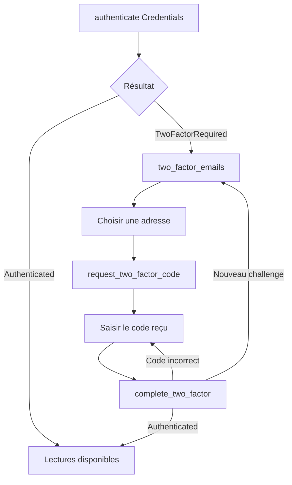

# Authentification et A2F

[Sommaire](README.md) · [Référence API](reference-api.md)

## Les quatre entrées `Auth`

| Variante | Entrée | Réseau à l’authentification | Renouvellement du JWT |
|---|---|---|---|
| `Credentials { email, password }` | Compte Renault | Login Gigya, A2F éventuellement nécessaire | Oui après login réussi |
| `SessionToken(String)` | Jeton de session Gigya | Demande de JWT, validant le jeton de session | Oui tant que Gigya accepte la session |
| `AccessToken(String)` | JWT d’accès | Aucun appel : inspection locale des claims | Non, aucun jeton de session disponible |
| `RestoredSession(SessionCredentials)` | Jeton de session + appareil | Demande de JWT | Oui tant que la session reste valide |

Chaque appel à `authenticate` remplace l’authentification locale précédente,
efface le challenge A2F et les codes modèles mémorisés. Les identifiants de
l’appareil sont conservés, sauf remplacement par `RestoredSession`.

Après une erreur de nouvelle connexion, ne pas supposer que l’ancienne session
reste utilisable. Reprendre explicitement le parcours d’authentification.

## Résultat de connexion

`AuthOutcome::Authenticated` signifie que le mode choisi a été installé. Pour
les identifiants, le login a retourné un jeton de session ; le JWT sera demandé
au premier appel protégé. Pour un JWT fourni directement, les claims ont été
lus, mais le serveur n’a pas encore confirmé sa validité.

`AuthOutcome::TwoFactorRequired` signifie qu’un challenge email doit être traité.
Ce résultat n’est pas une exception. Les lectures protégées ne sont pas encore
disponibles. Aucun code email n’est envoyé automatiquement par `authenticate`.

## Parcours A2F



Le même client doit vivre pendant tout le parcours. Ses clones partagent aussi
le challenge, mais deux interfaces ne doivent pas piloter simultanément deux
codes différents sur cette même session.

## Connexion asynchrone depuis un compte

```rust,no_run
# async fn begin(email: String, password: String) -> renault_api::Result<(renault_api::RenaultApi, renault_api::AuthOutcome)> {
use renault_api::{Auth, RenaultApi, Config};

let api = RenaultApi::new(Config::new("fr_FR")?)?;
let outcome = api.authenticate(Auth::Credentials { email, password }).await?;
// Conserver `api` dans le contrôleur de connexion de l’application.
# Ok((api, outcome))
# }
```

Lorsque le résultat est `TwoFactorRequired`, appeler `two_factor_emails()`.
Chaque entrée contient un `id` opaque à envoyer au serveur et une adresse
`obfuscated` éventuellement absente. Afficher cette adresse masquée ; ne pas
essayer de la reconstruire à partir de l’ID.

```rust,no_run
# async fn send_code(api: &renault_api::RenaultApi) -> renault_api::Result<()> {
use renault_api::RenaultError;

let emails = api.two_factor_emails().await?;
match emails.as_slice() {
    [] => return Err(RenaultError::NoTwoFactorEmail),
    [_] => api.request_two_factor_code(None).await?,
    _ => {
        // L’interface doit sélectionner un ID issu de `emails`, puis appeler :
        // api.request_two_factor_code(Some(&selected_id)).await?;
        return Err(RenaultError::EmailSelectionRequired);
    }
}
# Ok(())
# }
```

Avec un ID explicite, la bibliothèque vérifie qu’il appartient à la liste
retournée. Un ID inconnu produit `InvalidInput`. L’envoi du code renseigne le
jeton de vérification du challenge ; il ne termine pas la connexion.

## Valider et réessayer

```rust,no_run
# async fn verify(api: &renault_api::RenaultApi, code: &str) -> renault_api::Result<renault_api::AuthOutcome> {
use renault_api::RenaultError;

match api.complete_two_factor(code, true).await {
    Ok(outcome) => Ok(outcome),
    Err(RenaultError::InvalidVerificationCode) => {
        // Garder ce client et demander une nouvelle saisie à l’utilisateur.
        Err(RenaultError::InvalidVerificationCode)
    }
    Err(error) => Err(error),
}
# }
```

`remember_device = true` envoie `tempDevice=false` à Gigya. Cela demande de
reconnaître l’appareil ; la durée et la décision réelle restent contrôlées par
Gigya. `false` envoie `tempDevice=true`.

Un code incorrect laisse le challenge actif. Demander un nouveau code invalide
le jeton de vérification précédent localement. Après vérification réussie, la
bibliothèque garde l’assertion du fournisseur pour reprendre une finalisation
ayant échoué, sans soumettre à nouveau le code déjà accepté.

Après finalisation réussie, elle refait le login avec les identifiants temporaires.
Ce login peut à nouveau retourner `TwoFactorRequired` ; examiner le résultat de
`complete_two_factor`, pas seulement l’absence d’erreur.

Une perte de réponse réseau ne permet pas toujours de connaître l’état exact
côté serveur. Si Gigya refuse de poursuivre le challenge, l’annuler et relancer
la connexion ; aucune reprise universelle n’est garantie.

## Annuler et fermer

`cancel_two_factor` supprime le challenge et ses identifiants temporaires.
`logout` supprime aussi la session, les JWT, les cookies d’appareil et les codes
modèles. Ces opérations attendent le verrou ; elles n’interrompent pas
un appel réseau déjà en cours. Le logout est local et ne révoque pas Gigya.

## Export et restauration

```rust,no_run
# async fn restore(api: &renault_api::RenaultApi) -> renault_api::Result<()> {
use renault_api::{Auth, RenaultApi, Config};

if let Some(session) = api.session_credentials().await {
    // L’application peut sauvegarder `session` dans son coffre de secrets.
    let next = RenaultApi::new(Config::new("fr_FR")?)?;
    next.authenticate(Auth::RestoredSession(session)).await?;
}
# Ok(())
# }
```

`SessionCredentials` possède `login_token: String` et `device_ids: DeviceIds`.
`DeviceIds` possède `gmid` et `ucid`, chacun en `Option<String>`. Ils sont
sérialisables, mais la bibliothèque n’appelle aucune opération de stockage.
Le format de sérialisation public n’est pas une promesse de compatibilité
éternelle entre versions ; versionner son format applicatif si nécessaire.

Pour refaire un login par mot de passe en gardant la reconnaissance de l’appareil,
appeler `set_device_ids` avant `authenticate`. Pendant un challenge, remplacer
ces identifiants est refusé : annuler le challenge d’abord.

## Expiration et sécurité

Le JWT est réutilisé tant que `exp > heure_locale + 60 secondes`. Une horloge
système incorrecte peut donc produire des erreurs d’expiration. Le JWT fourni
directement doit lui aussi dépasser cette marge au moment de l’installation.

Le payload est décodé pour lire `exp` et `personId`, éventuellement dans `data`.
La signature n’est pas vérifiée localement : le serveur Renault valide le JWT.
Ne pas utiliser les claims décodés comme preuve d’identité dans l’application.

Le jeton de session peut expirer ou être révoqué indépendamment du JWT.
Les codes Gigya `403005` et `403013` sont reconnus comme une session expirée.
Sur la demande de JWT ou d’informations de compte, cette erreur efface les
identifiants de session locaux concernés. Une nouvelle connexion est nécessaire.

Le mot de passe n’est conservé que temporairement pour un parcours A2F nécessitant
un second login. Ses copies internes gérées par `Zeroizing` sont effacées à leur
destruction ; cela ne garantit pas l’effacement de toutes les copies ayant
transité dans la pile HTTP ou dans l’application appelante.
